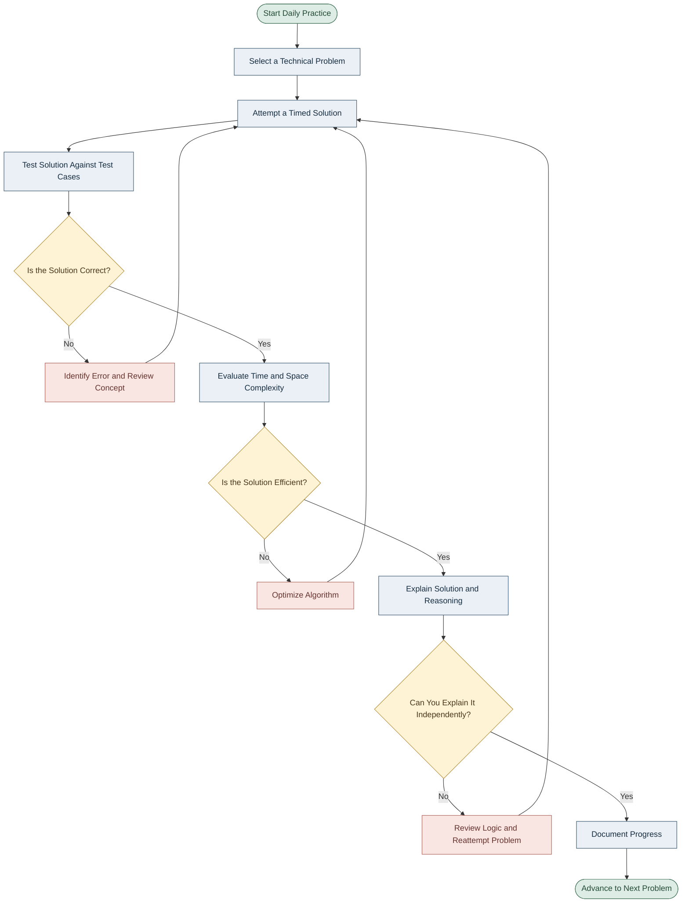

# Graduation Learning Plan for a Quantitative Developer Career

**Prepared for:** Computer Science Students Pursuing Quantitative Development

**Prepared by:** Annanya Singh

**Date:** November 24, 2026

*© 2020 Kaptan Ravi Thakkar. [Wikimedia Commons](https://commons.wikimedia.org/wiki/File:Stocks-market.jpg). Licensed under [CC BY-SA 4.0](https://creativecommons.org/licenses/by-sa/4.0/).*

---

## Table of Contents

- [Purpose](#purpose)
- [Selecting Relevant Coursework](#selecting-relevant-coursework)
  - [Strengthening Mathematical Foundations](#strengthening-mathematical-foundations)
  - [Selecting Computer Science Courses](#selecting-computer-science-courses)
  - [Developing Financial Knowledge](#developing-financial-knowledge)
- [Developing Technical Skills](#developing-technical-skills)
  - [Mastering Programming Languages](#mastering-programming-languages)
  - [Building Quantitative Projects](#building-quantitative-projects)
  - [Documenting Technical Projects](#documenting-technical-projects)
- [Gaining Professional Experience](#gaining-professional-experience)
  - [Pursuing Relevant Internships](#pursuing-relevant-internships)
  - [Preparing for Technical Interviews](#preparing-for-technical-interviews)
  - [Evaluating Interview Performance](#evaluating-interview-performance)
- [References](#references)

---

## Purpose

Breaking into quantitative development requires more than completing a computer science degree. Employers expect you to demonstrate programming proficiency, mathematical reasoning, and an understanding of financial markets. Without practical experience, you may struggle to distinguish yourself from other qualified graduates. This graduation learning plan provides best practices for strengthening your academic foundation, building a technical portfolio, and developing the professional qualifications necessary to compete for quantitative development positions before graduation.

## Selecting Relevant Coursework

Build an academic foundation that connects computer science, mathematics, and financial applications.

### Strengthening Mathematical Foundations

Quantitative developers rely on mathematical concepts to implement financial models and evaluate investment risk. Employers value mathematical reasoning because inaccuracies in financial calculations can influence trading decisions and financial outcomes.[^3]

Complete coursework in probability, statistics, linear algebra, and calculus before graduation. Apply mathematical concepts to programming assignments involving financial data.

### Selecting Computer Science Courses

Trading systems process substantial amounts of information under strict performance requirements. Employers value knowledge of algorithms and data structures because inefficient implementations can increase processing time and operational costs.[^1]

Complete courses in data structures, algorithms, databases, and software engineering. Confirm course prerequisites and graduation requirements with your academic advisor.

### Developing Financial Knowledge

Understanding financial markets allows you to develop software that supports meaningful trading decisions rather than simply performing calculations. Financial knowledge also helps you recognize when computational results are inconsistent with market behavior.

Complete an introductory finance course covering financial markets, investment principles, and portfolio management. Connect these concepts to your programming assignments.

## Developing Technical Skills

Strengthen your programming abilities through consistent practice and independent development projects.

### Mastering Programming Languages

Python supports financial data analysis, while C++ enables performance-sensitive trading infrastructure. Employers value proficiency in both languages because quantitative development requires analytical flexibility and computational efficiency.[^1]

Practice Python and C++ daily through programming exercises on [LeetCode](https://leetcode.com/). Evaluate your solutions for execution time, memory usage, and readability.

### Building Quantitative Projects

Independent projects demonstrate your ability to translate mathematical concepts into functional software. Employers value this experience because quantitative developers must implement, test, and maintain financial applications.[^2]

Develop a portfolio analysis application using historical stock market data. Calculate investment returns, evaluate portfolio performance, and test your calculations against expected results.

### Documenting Technical Projects

Technical documentation allows employers to evaluate your reasoning, development decisions, and ability to communicate complex information. It also helps other developers understand and reproduce your work.

Publish your portfolio analysis application on [GitHub](https://github.com/). Include installation instructions, calculation methods, testing results, assumptions, and project limitations in the repository's README file.

## Gaining Professional Experience

Translate your academic knowledge and technical abilities into qualifications that demonstrate workplace readiness.

### Pursuing Relevant Internships

Quantitative development internships expose you to production software, collaborative development, and financial systems. Employers value internship experience because it demonstrates your ability to apply technical knowledge under professional constraints.[^4]

Search for quantitative development internships weekly. Tailor your resume to emphasize your financial programming project and relevant coursework. Schedule a resume review through the [University of Washington Career & Internship Center](https://careers.uw.edu/) before submitting applications.

### Preparing for Technical Interviews

Employers use technical interviews to evaluate whether you can develop efficient solutions, identify computational limitations, and communicate your reasoning. Programming and algorithm questions assess your ability to build reliable software, while probability questions evaluate your ability to reason about uncertainty in financial systems.

Complete one timed technical interview problem daily. Explain your reasoning aloud, implement your solution, and evaluate its time and space complexity.

### Evaluating Interview Performance

Repeated practice without evaluating mistakes can reinforce ineffective problem-solving habits. Employers value candidates who identify errors, respond to feedback, and improve their solutions because these abilities support reliable software development.

Follow the interview practice cycle in Figure 1. Record unsuccessful attempts, review the underlying concepts, and repeat each problem until you can produce and explain a correct, efficient solution independently.

**Figure 1.** Technical interview practice and evaluation cycle. The decision points determine whether you need to review foundational concepts, improve algorithm efficiency, or strengthen your ability to communicate technical reasoning before advancing to a new problem.

---

## References

[1] JPMorgan Chase & Co., "Quantitative Trading & Research, Quantitative Developer - Associate," *JPMorgan Chase Careers*, n.d. [Online]. Available: https://jpmc.fa.oraclecloud.com/hcmUI/CandidateExperience/en/sites/CX_1002/job/210789767/. [Accessed Nov. 5, 2026].

[2] IMC Trading, "Quantitative Developer," *IMC Careers*, n.d. [Online]. Available: https://www.imc.com/us/careers/jobs/4778139101. [Accessed Nov. 5, 2026].

[3] MathWorks, "Financial Toolbox Documentation," *MathWorks*, n.d. [Online]. Available: https://www.mathworks.com/help/finance/. [Accessed Oct. 27, 2026].

[4] Citadel, "A Day with Jonathan: Inside a Quantitative Development Internship at Citadel," *Citadel*, 22 July 2026. [Online]. Available: https://www.citadel.com/careers/career-perspectives/a-day-with-jonathan-intern/. [Accessed Oct. 27, 2026].

[^1]: JPMorgan Chase & Co., "Quantitative Trading & Research, Quantitative Developer - Associate," *JPMorgan Chase Careers*, n.d.

[^2]: IMC Trading, "Quantitative Developer," *IMC Careers*, n.d.

[^3]: MathWorks, "Financial Toolbox Documentation," *MathWorks*, n.d.

[^4]: Citadel, "A Day with Jonathan: Inside a Quantitative Development Internship at Citadel," *Citadel*, 22 July 2026.
