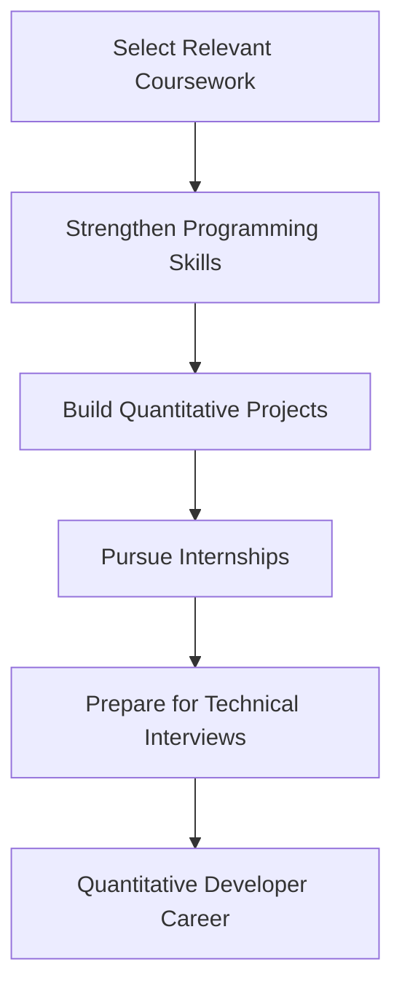

# Graduation Learning Plan for a Quantitative Developer Career

**Prepared for:** Computer Science Students Pursuing Quantitative Development

**Prepared by:** Annanya Singh 

**Date:** November 5, 2026

## Table of Contents

- [Purpose](#purpose)
- [Selecting Relevant Coursework](#selecting-relevant-coursework)
  - [Strengthening Mathematical Foundations](#strengthening-mathematical-foundations)
  - [Choosing Programming and Finance Courses](#choosing-programming-and-finance-courses)
- [Developing Technical Skills](#developing-technical-skills)
  - [Mastering Programming Languages](#mastering-programming-languages)
  - [Building Quantitative Projects](#building-quantitative-projects)
- [Gaining Professional Experience](#gaining-professional-experience)
  - [Pursuing Relevant Internships](#pursuing-relevant-internships)
  - [Preparing for Technical Interviews](#preparing-for-technical-interviews)
- [References](#references)

## Purpose

Breaking into quantitative development can be challenging because employers expect candidates to demonstrate strong programming abilities, mathematical reasoning, and an understanding of financial markets. Completing a computer science degree alone may not provide enough practical experience to meet these expectations. To remain competitive, you must strategically select coursework, develop technical skills, and pursue professional opportunities before graduation. This graduation learning plan outlines best practices for strengthening your academic foundation, building a technical portfolio, and preparing for internships and full-time quantitative development positions.

## Selecting Relevant Coursework

Your course selections should strengthen the technical and analytical knowledge required for quantitative development. Prioritize subjects that connect computer science with mathematics and financial applications.

### Strengthening Mathematical Foundations

Quantitative Developers use mathematical concepts to implement and evaluate financial models. Knowledge of probability, statistics, linear algebra, and calculus helps you understand the algorithms behind pricing, risk analysis, and trading systems.[^3]

Prioritize courses in probability, statistics, linear algebra, and calculus to strengthen your mathematical foundation. Apply these concepts through programming assignments involving financial datasets, statistical analysis, or algorithm development. When possible, select electives that connect mathematical theory with practical computational applications.

### Choosing Programming and Finance Courses

Programming and financial knowledge complement mathematical skills in quantitative development. Courses involving data structures, algorithms, databases, and financial markets help you understand both the software and its applications.

Select computer science electives focused on algorithms, data structures, databases, and software development. Consider introductory finance courses to become familiar with financial markets and investment concepts. Prioritize courses offering hands-on programming projects that demonstrate your ability to apply technical knowledge.

Consult your academic advisor to confirm prerequisites and ensure your selected courses align with your graduation timeline.

## Developing Technical Skills

Quantitative development requires programming proficiency and practical problem-solving abilities. Strengthening these skills beyond classroom assignments helps you demonstrate your readiness for financial software engineering roles.

### Mastering Programming Languages

Python supports financial data analysis and model development, while C++ is valuable for building high-performance trading systems. Employers also emphasize efficient algorithms, data structures, and software reliability.[^1]

Practice Python and C++ consistently through coding challenges, independent projects, and coursework. Use platforms such as [LeetCode](https://leetcode.com/) to strengthen your understanding of algorithms and data structures. Focus on improving code efficiency, readability, and reliability while developing solutions to increasingly complex problems.

### Building Quantitative Projects

Personal projects demonstrate your ability to apply programming and mathematical concepts to realistic financial problems. Backtesting systems and market-data analysis tools provide opportunities to practice implementing and evaluating quantitative models.[^2]

**Figure 1.** Key areas of preparation for a quantitative development career. Each stage contributes to the academic knowledge, technical experience, and professional readiness needed to pursue quantitative development positions.

Build a portfolio of quantitative programming projects using historical financial data. Consider developing a trading strategy backtester, financial data visualization tool, or market analysis application. Use [GitHub](https://github.com/) to organize your repositories, document your methodology, and demonstrate your programming abilities.

Include performance metrics, testing procedures, assumptions, and project limitations in each repository. Clear documentation allows recruiters to evaluate your technical reasoning and understand how you approach realistic financial problems.

## Gaining Professional Experience

Professional experience helps you apply technical knowledge in real financial environments. Internships and interview preparation can strengthen your qualifications before graduation.

### Pursuing Relevant Internships

Internships at trading firms, investment banks, and financial technology companies provide exposure to production software and collaborative development. 
These experiences help you understand how quantitative systems operate under practical constraints.[^4]

Research quantitative development internships at trading firms, investment banks, and financial technology companies early in your undergraduate education. Prioritize positions involving Python, C++, financial data, or trading infrastructure. Tailor your resume to highlight relevant coursework, technical projects, and programming experience.

Use the [University of Washington Career & Internship Center](https://careers.uw.edu/) to access internship opportunities, resume reviews, career fairs, and professional development resources. Attend employer networking events to learn about recruitment expectations and connect with professionals working in quantitative development.

### Preparing for Technical Interviews

Quantitative development interviews may assess programming, algorithms, probability, and problem-solving skills. Consistent preparation helps you communicate your reasoning and solve unfamiliar technical challenges.

Practice technical interview questions involving algorithms, data structures, probability, and mathematical reasoning. Use coding platforms such as LeetCode to develop your problem-solving skills and become comfortable explaining solutions under time constraints.

Schedule mock interviews through the [UW Career & Internship Center](https://careers.uw.edu/) or practice with classmates. Track recurring mistakes, review challenging concepts, and adjust your preparation based on feedback. Begin practicing several months before internship recruitment to build confidence and consistency.

## References

[1] JPMorgan Chase & Co., "Quantitative Trading & Research, Quantitative Developer - Associate," *JPMorgan Chase Careers*. [Online]. Available: https://jpmc.fa.oraclecloud.com/hcmUI/CandidateExperience/en/sites/CX_1002/job/210789767/. Accessed: Nov. 5, 2026.

[2] IMC Trading, "Quantitative Developer," *IMC Careers*. [Online]. Available: https://www.imc.com/us/careers/jobs/4778139101. Accessed: Nov. 5, 2026.

[3] MathWorks, "Financial Toolbox Documentation," *MathWorks*. [Online]. Available: https://www.mathworks.com/help/finance/. Accessed: Oct. 27, 2026.

[4] Citadel, "A Day with Jonathan: Inside a Quantitative Development Internship at Citadel," *Citadel*, Jul. 22, 2026. [Online]. Available: https://www.citadel.com/careers/career-perspectives/a-day-with-jonathan-intern/. Accessed: Oct. 27, 2026.

[^1]: JPMorgan Chase & Co., "Quantitative Trading & Research, Quantitative Developer - Associate," *JPMorgan Chase Careers*. [Online]. Available: https://jpmc.fa.oraclecloud.com/hcmUI/CandidateExperience/en/sites/CX_1002/job/210789767/. Accessed Nov. 5, 2026.

[^2]: IMC Trading, "Quantitative Developer," *IMC Careers*. [Online]. Available: https://www.imc.com/us/careers/jobs/4778139101. Accessed Nov. 5, 2026.

[^3]: MathWorks, "Financial Toolbox Documentation," *MathWorks*. [Online]. Available: https://www.mathworks.com/help/finance/. Accessed: Oct. 27, 2026.

[^4]: Citadel, "A Day with Jonathan: Inside a Quantitative Development Internship at Citadel," *Citadel*, Jul. 22, 2026. [Online]. Available: https://www.citadel.com/careers/career-perspectives/a-day-with-jonathan-intern/. Accessed: Oct. 27, 2026.

[Word Count: 607]

