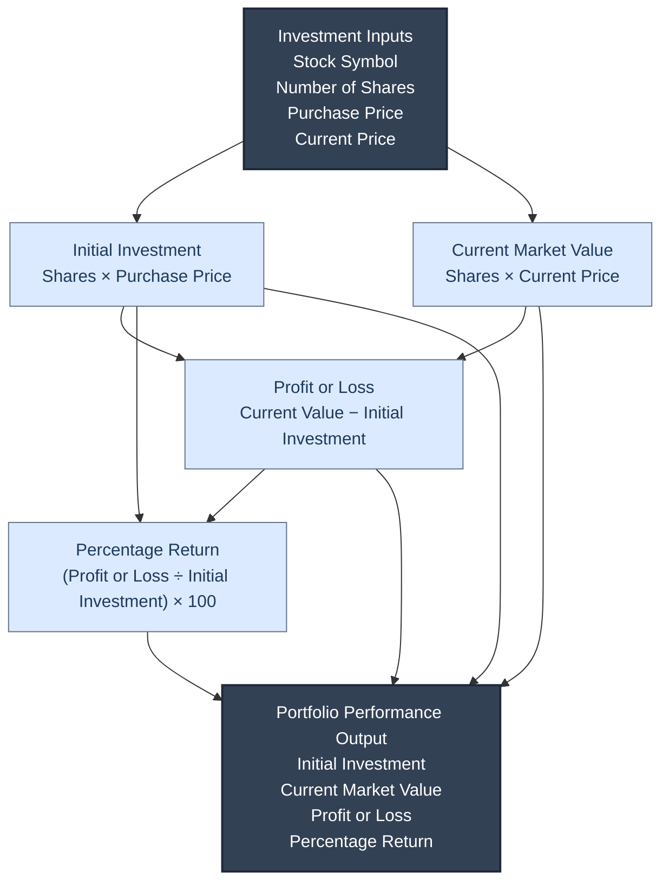

# Graduation Learning Plan for a Quantitative Developer Career

**Prepared for:** Computer Science Students Pursuing Quantitative Development

**Prepared by:** Annanya Singh

**Date:** November 24, 2026

*© 2020 Kaptan Ravi Thakkar. [Wikimedia Commons](https://commons.wikimedia.org/wiki/File:Stocks-market.jpg). Licensed under [CC BY-SA 4.0](https://creativecommons.org/licenses/by-sa/4.0/).*

---

## Table of Contents

- **[Purpose](#purpose)**
- **[Selecting Relevant Coursework](#selecting-relevant-coursework)**
  - [Strengthening Mathematical Foundations](#strengthening-mathematical-foundations)
  - [Developing Computational Knowledge](#developing-computational-knowledge)
- **[Developing Technical Skills](#developing-technical-skills)**
  - [Strengthening Programming Proficiency](#strengthening-programming-proficiency)
  - [Building a Quantitative Project](#building-a-quantitative-project)
  - [Documenting Technical Projects](#documenting-technical-projects)
- **[Gaining Professional Experience](#gaining-professional-experience)**
  - [Pursuing Relevant Internships](#pursuing-relevant-internships)
  - [Building Professional Connections](#building-professional-connections)
- **[Preparing for Technical Interviews](#preparing-for-technical-interviews)**
  - [Practicing Algorithmic Problem-Solving](#practicing-algorithmic-problem-solving)
  - [Developing Probabilistic Reasoning](#developing-probabilistic-reasoning)
- **[References](#references)**

---

## Purpose

Breaking into quantitative development can be challenging because employers expect you to demonstrate programming proficiency, mathematical reasoning, and an understanding of financial markets. Completing a computer science degree alone may not provide sufficient practical experience to meet these expectations. By strategically developing your academic knowledge, technical portfolio, and professional experience before graduation, you strengthen your qualifications and distinguish yourself from other applicants. This graduation learning plan outlines best practices for preparing for internships and full-time quantitative development positions.

## Selecting Relevant Coursework

Your coursework establishes the mathematical and computational foundation necessary for developing reliable financial software.

### Strengthening Mathematical Foundations

Quantitative development involves implementing financial models that depend on mathematical accuracy. Understanding probability, statistics, linear algebra, and calculus helps you evaluate financial calculations and recognize errors that could compromise trading decisions.[^1]

Complete coursework in calculus, linear algebra, probability, and statistics before graduation. Incorporate these mathematical concepts into programming assignments involving financial calculations and data analysis.

### Developing Computational Knowledge

Financial software processes substantial amounts of data under performance constraints. Knowledge of algorithms and data structures enables you to develop efficient software without unnecessary computational costs.

Prioritize computer science electives in algorithms, data structures, and database systems. Confirm your course sequencing with your academic advisor before registering each quarter.

## Developing Technical Skills

Independent technical development strengthens your ability to apply classroom knowledge to practical financial problems.

### Strengthening Programming Proficiency

Python supports financial data analysis, while C++ enables the development of high-performance trading systems. Employers value proficiency in these languages because quantitative software requires computational efficiency and reliable implementation.[^2]

Develop your financial programming skills through Python projects and reinforce your C++ proficiency through coursework and daily programming practice.

### Building a Quantitative Project

A financial programming project demonstrates your ability to translate mathematical concepts into functioning software. Employers can evaluate your technical reasoning through the organization and accuracy of your implementation.[^3]

Develop a Python-based stock portfolio analysis application. Incorporate the computational relationships illustrated in Figure 1 to connect investment inputs, financial calculations, and portfolio performance.

**Figure 1. Computational structure of a stock portfolio analysis application**

The computational relationships ensure that percentage returns reflect the initial investment rather than the current market value, supporting accurate performance evaluation.

### Documenting Technical Projects

Clear documentation allows employers to assess your programming decisions, reproduce your results, and understand your project's limitations. It also demonstrates the communication skills necessary for collaborative software development.

Publish your completed project on [GitHub](https://github.com/). Include a README documenting the project's purpose, methodology, execution requirements, testing procedures, and limitations.

## Gaining Professional Experience

Professional engagement helps you understand industry expectations and apply your technical knowledge beyond academic settings.

### Pursuing Relevant Internships

Quantitative development internships provide exposure to production software, collaborative engineering, and financial systems operating under practical constraints.[^4] Employers value this experience because it demonstrates your ability to contribute within professional environments.

Research quantitative development internships weekly and submit tailored applications that emphasize your programming experience, mathematical coursework, and financial programming project.

### Building Professional Connections

Professional connections provide insight into recruitment expectations and technical responsibilities that job descriptions may not fully communicate. These relationships help you identify gaps in your qualifications.

Contact one University of Washington alumnus working in quantitative development each week through [LinkedIn](https://www.linkedin.com/). Use informational interviews to identify technical competencies and recruitment expectations relevant to your career goals.

## Preparing for Technical Interviews

Technical interviews allow employers to evaluate how effectively you apply your knowledge to unfamiliar problems.

### Practicing Algorithmic Problem-Solving

Employers evaluate algorithmic reasoning because inefficient software can increase processing delays and computational costs in trading systems. Explaining your reasoning also demonstrates your ability to communicate technical decisions during collaborative development.

Complete one algorithms or data structures problem daily on [LeetCode](https://leetcode.com/). Explain your solution, evaluate its time and space complexity, and document recurring mistakes for weekly review.

### Developing Probabilistic Reasoning

Employers assess probability skills because financial markets operate under uncertainty. Strong probabilistic reasoning helps you understand financial models, identify inaccurate assumptions, and evaluate potential outcomes without treating uncertain predictions as guaranteed results.

Complete three probability practice problems each week. Document your mathematical reasoning and review incorrect solutions to identify weaknesses in your understanding.

## References

[1] MathWorks, "Financial Toolbox Documentation," *MathWorks*, n.d. [Online]. Available: https://www.mathworks.com/help/finance/. [Accessed Oct. 27, 2026].

[2] JPMorgan Chase & Co., "Quantitative Trading & Research, Quantitative Developer - Associate," *JPMorgan Chase Careers*, n.d. [Online]. Available: https://jpmc.fa.oraclecloud.com/hcmUI/CandidateExperience/en/sites/CX_1002/job/210789767/. [Accessed Nov. 5, 2026].

[3] IMC Trading, "Quantitative Developer," *IMC Careers*, n.d. [Online]. Available: https://www.imc.com/us/careers/jobs/4778139101. [Accessed Nov. 5, 2026].

[4] Citadel, "A Day with Jonathan: Inside a Quantitative Development Internship at Citadel," *Citadel*, 22 July 2026. [Online]. Available: https://www.citadel.com/careers/career-perspectives/a-day-with-jonathan-intern/. [Accessed Oct. 27, 2026].

[^1]: MathWorks, "Financial Toolbox Documentation," *MathWorks*, n.d. [Online]. Available: https://www.mathworks.com/help/finance/. [Accessed Oct. 27, 2026].

[^2]: JPMorgan Chase & Co., "Quantitative Trading & Research, Quantitative Developer - Associate," *JPMorgan Chase Careers*, n.d. [Online]. Available: https://jpmc.fa.oraclecloud.com/hcmUI/CandidateExperience/en/sites/CX_1002/job/210789767/. [Accessed Nov. 5, 2026].

[^3]: IMC Trading, "Quantitative Developer," *IMC Careers*, n.d. [Online]. Available: https://www.imc.com/us/careers/jobs/4778139101. [Accessed Nov. 5, 2026].

[^4]: Citadel, "A Day with Jonathan: Inside a Quantitative Development Internship at Citadel," *Citadel*, 22 July 2026. [Online]. Available: https://www.citadel.com/careers/career-perspectives/a-day-with-jonathan-intern/. [Accessed Oct. 27, 2026].

Word Count: 667
